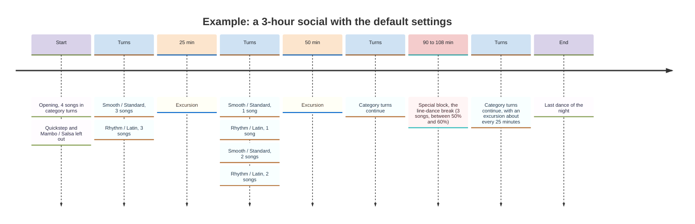
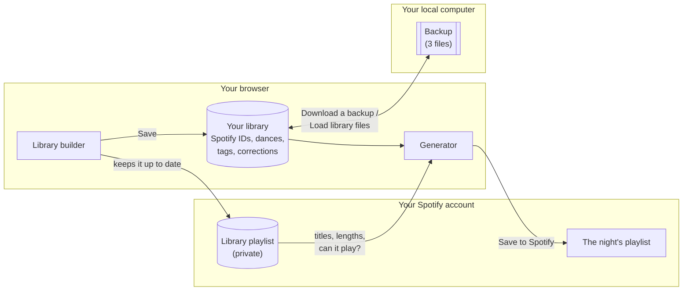
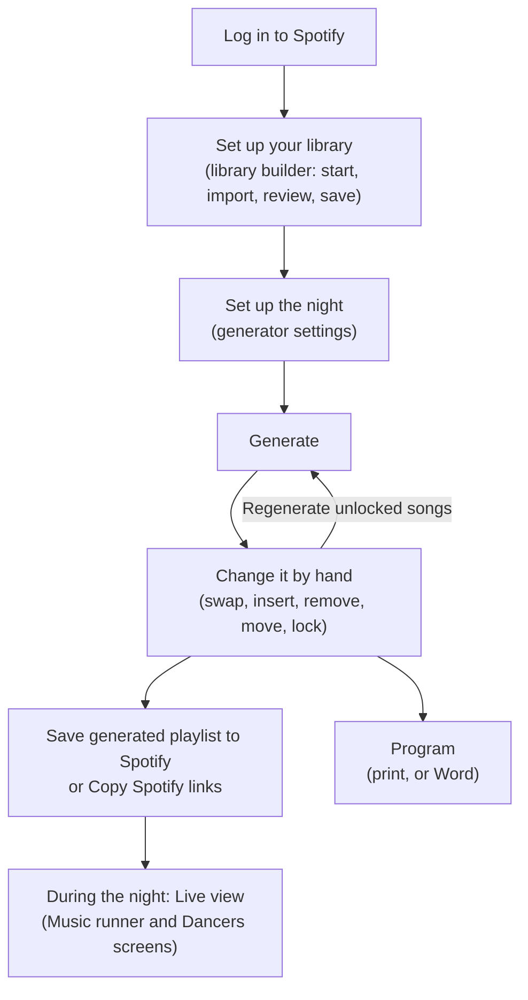

# A playlist generator for social dance events

## Definitions

For the purposes of this readme, please note the following dance-related definitions:

* **Song:** an individual piece of music, irrespective of whatever dance(s) may be associated with it.
* **Dance** (n): a categorical identity for a collection of bodily motions that may be done in rhythm or in time with a **song**.
* **Category:** a categorical identity for a collection of **dances** (equivalent to the competitive ballroom term "style").

"Oye Como Va" is a song. The cha-cha is a dance. International Latin is a category (i.e. a style) containing five dances, of which one is the cha-cha.

Please note that colloquial language will often blur the lines between hard definitions, often used as lexical shorthand to more quickly get a point across. For example, the phrase "'Oye Como Va' is a cha-cha" is shorthand for "'Oye Como Va' is a song to which you can dance the cha-cha".

Please also note the following other definitions:

* **Tag (n):** a label given to a song that describes something other than its dance; e.g. "Hollywood" for a song from a film, or "tempo change" for a song whose speed changes. A song can have any number of tags.
* **Association:** a group of dances treated as one, because their music is interchangeable. For example, "Waltz" associates Smooth Waltz and Standard Waltz.
* **Turn (n):** a run of songs from the same category, before the playlist moves on to the next category (see rule 6).
* **Excursion:** a song or dance that is outside of the defined categories for a single particular playlist.
* **Opening (n):** the first few songs of the night (the **Opening length**). With a theme, these songs are the **openers**.
* **Theme** (n): what a particular event is about (e.g. Hollywood, Roarin' Twenties, Hustle night), expressed as a set of dances and/or song tags. A song that is played as a theme dance, or that carries a theme tag, is a **theme song**, and the **theme share** is the part of the night's songs that are theme songs.
* **Special block:** a run of songs at one point in the night: songs of chosen dances (e.g. a line-dance break, or a single Paso Doble), songs that carry one tag, or songs you chose yourself (see rules 3, 4 and 10).
* **Must-play song:** a song that has to play at some point in the night (see rule 12).
* **Duplicate (n):** the same recording of a song under a different Spotify ID; e.g. a single and its album version.
* **Version:** a different recording of the same song; e.g. a cover, a live version, or a remaster. All versions of a song together form one **work**.
* **Library:** your collection of songs, with the dance(s), tags and corrections you gave each one. It is kept in your browser (see "Using the app"). The **shared library** is a ready-made library that anyone can start from.
* **Library playlist:** a private playlist in your Spotify account that holds your whole library. The app keeps it up to date and reads the songs' titles and lengths from it; you never need to change it yourself.
* **Settings file** (or **preset**): a saved setup of a night, i.e. everything on the generator page's settings. **Shared presets** are settings files that anyone can load from the site.
* **Spotify key:** what connects the app to Spotify on your behalf. Every user needs a Spotify account, and either uses the site's key or their own (see "Using the app").

---

## Introduction

Creating a playlist for a dance social takes a certain artistry to ensure that said playlist meets a large number of criteria; many of these criteria are unwritten. The efforts required to meet these criteria can be extensive. Furthermore, because different social events may have different themes, necessitating slightly different song choices between different playlists, it is often not feasible to reuse any one playlist for a different social event without completely redoing the entire song order. This app is designed to randomly generate a playlist subject to a number of rules, and to save it straight to Spotify. Because the author has a strong background in competitive ballroom, many of the examples and default settings are from the perspective of ballroom.

Our conception of a dance playlist is as follows:

1. All dances in question are condensed wherever stylistic similarities are possible, using **associations**: e.g., Standard Waltz and Smooth Waltz are simply "Waltz". In competitive ballroom there are 19 dances in four styles: American Rhythm (Cha-cha, Rumba, Swing, Bolero, Mambo), American Smooth (Waltz, Tango, Foxtrot, Viennese Waltz), International Standard (Waltz, Tango, Viennese Waltz, Foxtrot, Quickstep), and International Latin (Cha-cha, Samba, Rumba, Paso Doble, Jive). Dances that share a name are associated by default, with two exceptions: American and International Rumba are *not* associated, while American Bolero and International Rumba *are* associated. Similarly, Swing / Jive and Salsa / Mambo may have similar enough music to be considered the same. All dances are then organized into the minimum number of categories required to maintain distinct identities. For example, the four styles in competitive ballroom condense to two categories: Smooth / Standard and Rhythm / Latin. For categories with highly unique dances (e.g. Paso Doble), the user has the option of excluding these dances from the overall pool, to be handled separately (e.g. as a special block).
2. Apart from the dances within the primary categories, there is also a small percentage of excursion dances (e.g. West Coast Swing, Hustle, Bachata, etc. are NOT normally danced in competitive ballroom). These occur on a timer: **Every** *x* minutes (by default 25), with an optional **Random variation** of ± a few minutes, so that they do not come like clockwork. These dances work on a sort of reducing-pool die. The user is responsible for weighting each dance (its **Max count**) to their desired odds. Every time one of these excursions is rolled, the app will roll for a dance based on these weights. Once a dance is selected, a single occurrence of that dance is subtracted from the pool. For example, consider Polka, Hustle, and Bachata as three excursion dances, weighted at 1, 1, and 3, respectively. If the first excursion is a Bachata, then the odds become 1, 1, and 2, respectively; if the second excursion is another Bachata, then the odds become 1, 1, and 1, respectively; if the third excursion is yet another Bachata, then the odds become 1, 1, and 0, respectively, and no more Bachatas will play until the other two counters reach 0. If the counters reach 0, 0, and 0, then they reset to their initial values of 1, 1, and 3.

    ```mermaid
    flowchart LR
      S["Start<br/>Polka 1 · Hustle 1 · Bachata 3"] -- "Hustle" --> A["1 · 0 · 3"]
      A -- "Bachata" --> B["1 · 0 · 2"]
      B -- "Polka" --> C["0 · 0 · 2"]
      C -- "Bachata" --> D["0 · 0 · 1"]
      D -- "Bachata" --> E["0 · 0 · 0"]
      E -- "reset" --> S
    ```

3. There is the option to include line dancing. These may be handled like excursions, wherein they will appear occasionally throughout the night; or as a **special block** of dances, wherein they will appear as a single run at a set point (e.g. three line dances halfway through the night). A block of dances may list several dances; each of its songs is then one of them, varied where possible. Songs inside the block may follow each other closely, but the songs around the block keep the songs-between-repeats rule (rule 7) from it. Songs of a block of dances are never theme songs, and do not count toward the theme share.
4. Special blocks never interrupt each other: a block that comes due while another is playing waits until it ends. Blocks ticked **Keep apart from other special blocks** (by default, every block of dances) never play directly next to each other; e.g. a line-dance break and a single Paso Doble will not appear consecutively. Any block can also list dances or other blocks that it must **never directly follow**.
5. Many social events have a theme: e.g. Hollywood, Roarin' Twenties, etc. Furthermore, some social events have themed *dances*: e.g. Roarin' Twenties may lean towards using American swing dances (Foxtrot, Quickstep, Swing, Jive). It can be difficult to ensure that a playlist is populated with enough songs that match the theme, without feeling repetitive and boring. A theme lists **theme dances** and/or **theme song tags** (e.g. songs tagged "Hollywood").
    * **How often theme songs play.** The theme share stays between **Theme share at least** and **at most**. It does not count the opening, whose songs are theme songs anyway. For **broad** themes that do not focus on particular dances (e.g. Hollywood, whose songs can be any dance), the default is 50% to 70%. Event themes that *do* focus on particular dances (e.g. "Hustle night") are, by default, weighted 20% to 25% of the time. Consider that by default, the 19 competitive dances collapse into about 11 social dances; thus, if assuming an even 1/11 chance, a single dance will occur slightly less than 10% of the time. Therefore, increasing the occurrence of a single dance even to 25% of the entire event will make it feel as if it occurs twice as much as other dances. As such, the limits on the occurrence of thematic dances may be lower than expected.
    * **A limit to keep in mind: categories take turns equally.** A theme dance in a category only plays in that category's turns, so if every theme dance is in one of two categories, theme songs can make up only about half of the category songs (a little less, as excursions are not theme songs), whatever the theme share asks for. The settings check warns when the share asked for is out of reach. To go higher, add dances of the other categories to the theme, or split the theme dances' category into two, so it has two turns in three (the **Latin night** preset does this).
    * **Theme dances** are exempt from the shuffle-bag rule (rule 7), but not from the songs-between-repeats rule. A theme dance does not have to be in a category: one that is in no category and is not an excursion (e.g. Hustle on a "Hustle night" but for ballroom dancers) plays whenever a theme song is due, without taking a turn from the categories. If there are several such dances, none repeat until all have played at least once. A theme dance should not be listed as an excursion; the app will throw a warning if one is.
    * **Themes with tags.** A theme song with a tag keeps the shuffle-bag. If none fit the normal songs-between-repeats rule, the gap may shrink down to **Theme songs may repeat after at least** (by default, the normal gap minus 2). A theme defined with both tags and dances picks one of the two at random each time a theme song is due (weighted by how many tags and dances it has).
    * **Openers.** If a social event has a theme, the opening songs always match it. When the theme has theme dances, the openers are theme dances, and the other rules do not apply to them: a Foxtrot night may open with several Foxtrots in a row, and a theme dance may open even if it is not allowed in the opening (rule 9). With several theme dances, they take turns equally, and the same dance never opens twice in a row: for example, with theme dances A and B and four openers, the night opens ABAB or BABA. If there are more theme dances than openers, the ones left over do not open. For a theme of song tags, excursion songs with the tag may also open the night. After the openers, the normal rules apply again.
    * **Excursions** are chosen by their own weights only; the theme does not decide them, but an excursion song that happens to be a theme song still counts toward the theme share.
6. Categories are interspersed; dancers should never feel that they are subject to a specific, known order of dances. However, we also believe that playlists should not exclusively alternate between categories, as categorical momentum (i.e. having multiple Ballroom or Latin dances in a row) can be a strongly positive feeling, plus gives a sense of having turns of similar dances. The maximum number of same-category dances in a row is **Max in a row**; the default is 3. The app will locally randomize the length of a turn up to this maximum; i.e., each turn of a category will be between 1 and 3 songs long. This length will only be rerolled after ALL categories have had their turn. I.e., for an event where the two categories are Ballroom and Latin, if the app rolls two Ballroom songs in a row, it will be followed by two Latin songs in a row before rerolling the length. This pattern will be interrupted by placement of excursions or special blocks.
7. Separately from interspersion is the topic of repetition. By default, no dance will be repeated until every dance in its category has played (the **shuffle-bag** rule); e.g., if the first Ballroom dance played is a Waltz, then another Waltz will not play until the Tango, Viennese Waltz, Foxtrot, and Quickstep have all occurred. Furthermore, dances will not repeat in a fixed order within a category. E.g., if you were to write down just the Ballroom dances of the night, you will NOT see a regularly patterned WTVFQ-WTVFQ-WTVFQ; rather, each group of five dances will be randomized, much like the block order in the game *Tetris*. There is further consideration for proximity of identical dances within the overall song order. Generally, it is not a good idea to have one song too close to another song of the same dance, even if both occurrences are interspersed by a different category. This behavior is handled by **Songs between repeats**, the minimum number of songs between two songs of the same dance (the default is 4). Lastly, theme dances (rule 5) are NOT prevented from repeating until all of the other dances within their category have occurred (i.e. they are excluded from the *Tetris* handling rules); however, they are still subject to the songs-between-repeats rule.
8. It may be desired to have a specific **last dance of the night**. If this is the case, the app keeps that song for the end. Either way, the night ends within about one song of the **Event length** (it may end a little early or run a little over, but never by a whole song). Note that the last song is also excluded from repetition rules (e.g. it is possible for both the penultimate and ultimate songs to be of the same dance). Songs that are too short or too long for the event can be excluded with **Shortest song allowed** and **Longest song allowed**.
9. The beginning of a social should be accessible. As such, the first few songs should not be songs that are too difficult and/or too fast. The **Opening length** defines how many songs should be played before the event is considered to have passed the beginning of the night, and the dances listed under **Not allowed in the opening** are always excluded from those songs (except theme dances in the openers, rule 5). By default, Mambo / Salsa and Quickstep are excluded (unless they are part of the overall theme), and the beginning of a social is defined as 4 songs long.
10. A night may have **special blocks**: e.g. a line-dance break halfway through, or four Hollywood songs at 40% of the night. A block takes its songs from **dances** (rule 3), from **a tag**, or plays **songs you choose**. If too few songs fit, a block is shorter, with a warning.
    * **A block with a tag** either takes part in the normal category turns (its songs are simply the next songs, each with the tag), or, with **Takes part in the category turns** unticked, plays any dance with the tag, outside the category turns. It keeps the shuffle-bag and the songs-between-repeats rules.
    * **A block of songs you choose** (found by tag, work, dance or category) plays exactly those songs, in your order, outside the category turns. They may break the song length limits, and never play elsewhere in the night (nor do their duplicates; other versions may). The block waits a few songs if one of its dances played too recently.
    * **Where it plays:** **at a point**, **at a random point** (after the opening and before the last 15% of the night), or **at a random point between** two values. A block that would start during the opening waits until the opening is over.
    * **Interruptions:** by default nothing interrupts a block: excursions and theme dances in no category wait until it ends. Each block can allow them to interrupt, and then either continue afterwards or end. Another special block never interrupts it (rule 4).
    * Blocks can be given a name, which labels their songs in the playlist, on the live view and in the program. Songs of a block with a tag, or of songs you choose, count toward the theme share only if they match the night's theme.
11. The same song should not play twice in a night in another form. **Duplicates** never play in the same night; they are recognized by the recording code that Spotify gives every song (its ISRC). **Versions** of the same song (recognized by title, whoever the artist) do not either, unless **No two versions of the same song in one night** (under Repetition) is switched off; if it cannot be met, it is relaxed as a last resort, with a warning. Titles can mislead (two different songs called "Hello"), so the library builder shows both, with filters, and lets you correct them: a **Work** box per song (pick a work by name to join it, or **Rename work…**), and **Not a duplicate** / **Same recording as…** buttons. A work is named after its oldest version: title and artist.
12. Some songs simply **must play** (requests, new favorites). **Must-play songs** are spread evenly through the night after the opening, in random order (with four of them, at about 20%, 40%, 60% and 80%). Each plays where it fits the rules (its category's turn, the shuffle-bag, the songs-between-repeats rule); if it still does not fit after a few songs, it plays anyway, with a warning. A must-play song plays only if its dance is in a category, is an excursion, or is a theme dance; it never plays elsewhere in the night, and it may break the song length limits.



---

## Using the app

The app is online at **https://maxluo97.github.io/dance-social-playlist-generator/**. It works on any device, and has two pages: the **generator** (where you set up a night and make its playlist) and the **library builder** (where you set up your library).

**You need a Spotify account.** There are two ways to connect; the **Spotify connection** panel on each page explains both:
- **The site's key:** The key supplied by the author. Spotify allows its usage for at most 5 accounts, which the site's owner adds by email. A free Spotify account is fine; ask the site's owner to add yours.
- **Your own key, or one shared with you by its owner:** a key's owner needs Spotify Premium, registers a small app in Spotify's developer dashboard, and can let up to 5 accounts use it. If someone shares their key with you, you do not need Premium.

**Your library consists of two pieces**: 1) information supplied by Spotify (title, artist, etc.), and 2) information not supplied by Spotify (dance information, "works", tags, etc.) The two pieces are separated to align with Spotify's Terms of Use, and are handled by having both an "offline" database, and a master song playlist on Spotify. Spotify's terms do not allow keeping its song details permanently, so the titles, artists, lengths and whether each song can play are read from your library playlist and kept in your browser for up to 14 days. Browser storage can be easily lost (e.g. by clearing a browser's data, or by using another browser or computer), so download a backup now and then; the app reminds you when your library has changes that are not in a backup.



To prepare your music for creating a library, it is highly encouraged for that music to be separated into individual playlists, where each playlist's title has the name of a dance. The library builder searches for dance names that match its own internal database; please also make sure that the playlist titles are spelled correctly. You do not need to worry about having the same songs in multiple playlists; the library builder handles duplicates automatically.



1. **Log in to Spotify.**
2. **Set up your library** in the **library builder** (from the generator page):
    * **Start from the shared library** (songs already sorted into dances and tagged, supplied by the author) or **Start empty**.
    * Import your single-dance playlists (each playlist's dance is guessed from its name), and add individual songs if needed.
    * Review the dances and tags, and the songs flagged as **Duplicates** or **Versions**; ▶ plays a song.
    * **Save.** Saving keeps the library in your browser and brings your library playlist up to date (the first save creates it). A song shown as "Unknown song" has no details from Spotify yet; saving puts it in your library playlist, and its details are then read.
    * **Download a backup** saves the library as three files, which **Load library files…** reads back, e.g. on another computer.
3. **Set up the night** on the generator page: categories, repetition, excursions, special blocks, must-play songs, the theme, and the opening and closing. **View library** shows your songs and which of them can play with these settings. Settings can be saved to and loaded from files; **Load default settings** starts over from the defaults, and **Shared presets…** offers the presets shared on the site, supplied by the author.
4. **Generate** a playlist. Songs that cannot be played on Spotify right now are never picked (**Refresh from Spotify** reads your library again). Then change it by hand:
    * Swap, insert and remove songs, and move them (drag a row, or use ↑ / ↓; a special block moves as a whole by its header line).
    * **Undo** takes back one change at a time; **Reset all** takes back every change.
    * **Lock** the songs you want to keep, and press **Regenerate unlocked songs** to redo the rest around them.
    * A block whose songs you scatter is broken up: its songs are locked and keep playing, but the block is not made again.
5. **Save to Spotify** creates the playlist in your account; or **Copy Spotify links** lets you paste the songs into a playlist yourself.
6. **During the night,** play the playlist in Spotify and open the **Live view** (it asks Spotify once for permission to see what is playing). It follows Spotify by itself, about every 5 seconds, whatever device plays the music, and also when you skip, go back or jump around.
    * The **Music runner** screen shows the song playing now (dance, title, artist, time), the next dance, the next special block ("in 3 songs"), and the next few songs.
    * The **Dancers** screen (**Open the Dancers screen**, then **Full screen**, e.g. on a projector) shows, in large print, the dance playing now with its title and artist, the next dance and the following dance.
    * A song that is not in the playlist shows as **Off the plan**. On the Music runner screen, either say which planned song it is ("It's #15…"), or **Add to the night** with its dance; the playlist's order does not change. **Check Spotify now** asks Spotify at once.
    * Changes made to the playlist on the generator page during the night show up on the live view.
7. **Program** shows the night's song order with each song's dance and special blocks, to **print** or **download as a Word document**. Song titles are not included, since Spotify's terms do not allow the app to keep copies of them; the Word document has an empty **Song name** column to fill in by hand.

---

## License

© 2026 Max Luo.

* **The app's code** is free software, licensed under the **GNU Affero General Public License, version 3 or later** (AGPL 3.0; see [LICENSE](LICENSE)). You may use, change and share it; if you share a changed version, or run one as a website, you must make its source code available under the same license.
* **The shared library and the presets** ([site/data/](site/data/), [site/presets/](site/presets/)) are licensed under **Creative Commons Attribution 4.0** (CC BY 4.0): you may reuse them with credit.
* **Spotify's logos** ([site/images/spotify/](site/images/spotify/)) belong to Spotify and are used under Spotify's design guidelines; they are not covered by these licenses.
* The app comes with no warranty (see the license).

---

## Roadmap

* **Before 1.0:** a guide for new users; a code cleanup pass; the default settings and a few shared presets.
